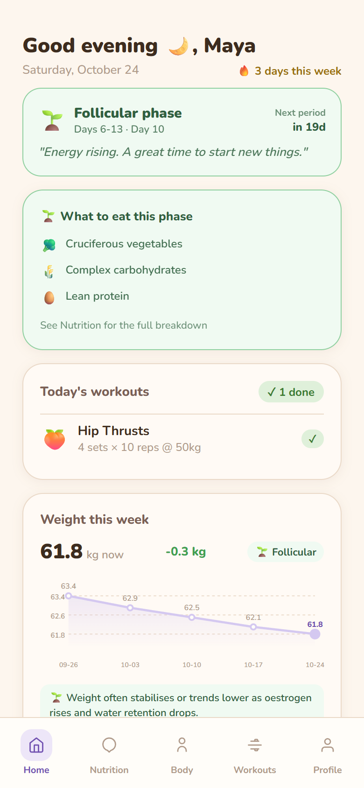
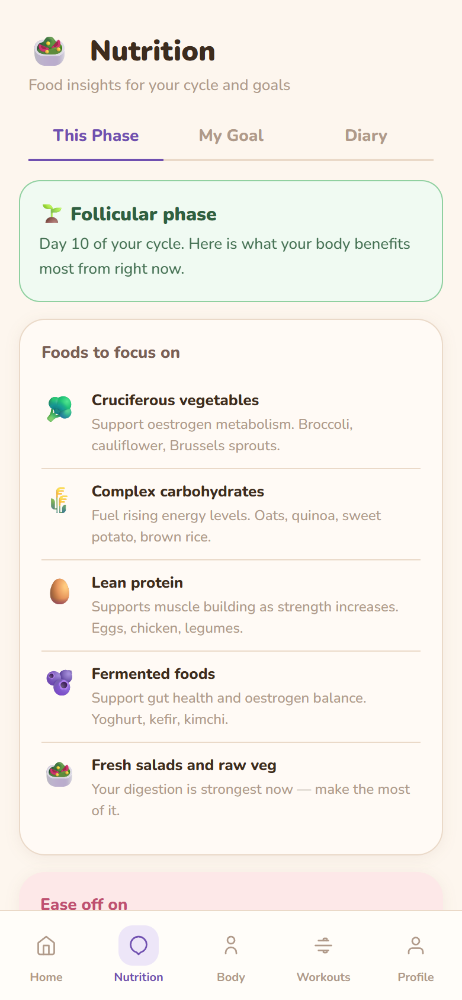
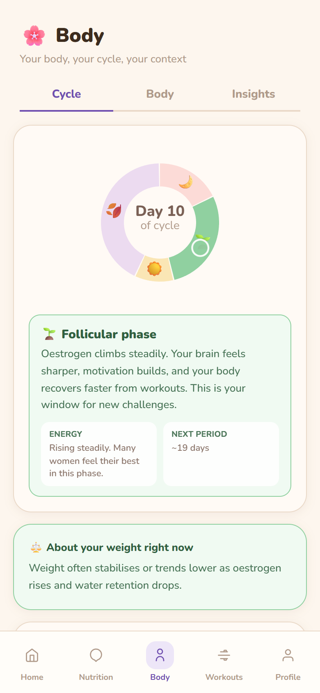
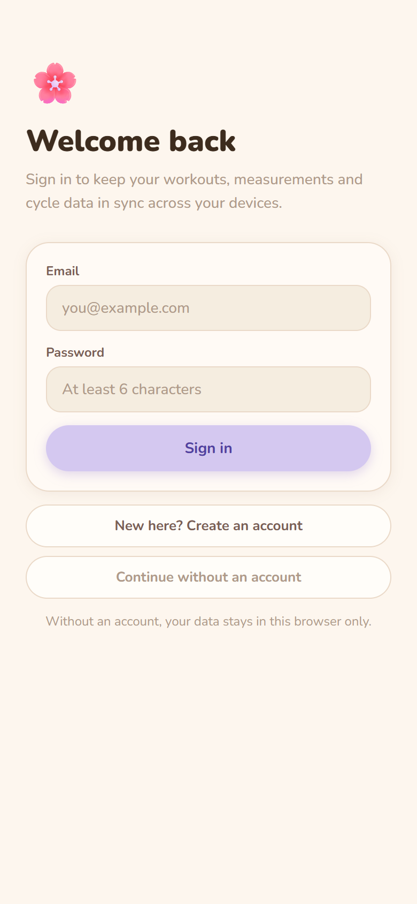

# Formly — AI Fitness & Nutrition Tracker for Women

[](https://github.com/franc13e/formly/actions/workflows/ci.yml)

Formly is a mobile-first fitness app that combines workout logging, nutrition tracking and optional menstrual-cycle tracking, with AI coaching that adapts to where you are in your cycle.

**Live demo:** https://formly-teal.vercel.app

**Tech Stack:** React 19 · TypeScript · Vite · Vitest · FastAPI · Groq LLM API · Supabase (auth + Postgres) · Vercel (frontend + serverless API)

---

## Screenshots

<p align="center">
  
  
  
  
</p>

## Features

- **Workout logging**: log workouts by type (cardio, strength, etc.), add notes and PRs, mark rest days, and swipe or tap to delete
- **Nutrition tracking**: describe what you ate and the AI estimates calories, protein, carbs, fats, sugar and fiber
- **AI workout plans**: personalised weekly plans based on your goal (lose fat, build muscle, tone, maintain), activity level and available days
- **Cycle-aware insights**: optional cycle tracking (menstrual, follicular, ovulation, luteal) that tailors body and progress insights to each phase
- **Body measurements**: track weight and measurements over time with supportive, non-judgemental AI feedback
- **Goal suggestions**: AI recommendations for which nutrients to prioritise for your goals
- **Responsive layout**: bottom navigation on mobile, sidebar layout on desktop
- **Optional accounts**: sign up with email to back up and sync your data across devices, or continue without an account and keep everything in the browser
- **Local-first**: the app works offline from localStorage; signed-in users' data is synced to Supabase in the background

## Project Structure

```
formly/
├── src/
│   ├── main.tsx          # React entry point
│   ├── App.tsx           # Root component: app state, persistence, navigation
│   ├── types.ts          # Shared domain types
│   ├── theme.ts          # Design tokens and global CSS
│   ├── vite-env.d.ts     # Vite / import.meta.env types
│   ├── pages/            # Onboarding, Dashboard, Nutrition, Body, Workouts, Settings
│   ├── components/       # Shared UI: icons, charts, rings, cycle wheel, AI coach panel
│   ├── data/             # Static data: workouts, foods, coach options, tabs
│   ├── hooks/            # useToast
│   ├── auth/             # Sign-in screen, auth gate and account context
│   └── lib/              # API client, storage, cloud sync, Supabase client, cycle engine (+ unit tests)
├── supabase/schema.sql   # user_state table + row-level security policies
├── api/index.py          # Vercel serverless entry for the FastAPI app
├── main.py               # FastAPI backend (AI endpoints)
├── requirements.txt      # Python dependencies
├── package.json          # Frontend dependencies and scripts
├── tsconfig.json         # TypeScript config (strict)
├── vite.config.ts        # Vite + Vitest config
└── vercel.json           # Vercel deployment config
```

## Accounts & Sync

Accounts are optional and use **Supabase Auth**. Each user's app data is stored as one row in a `user_state` table protected by **row-level security**, so users can only read and write their own data ([schema](supabase/schema.sql)).

- On sign-in, cloud data replaces the local copy; a brand-new account is seeded from the current local data, so guest progress carries over.
- Every change is saved locally first and synced in the background (debounced, and flushed when the tab is hidden).
- Without Supabase configured, the app runs fully local, exactly as before. The Supabase SDK is lazy-loaded, so local-only visitors don't download it.

The frontend reads the public Supabase URL and anon key from `GET /api/config`, which picks them up from the Vercel ↔ Supabase integration's environment variables.

## API Endpoints

| Method | Endpoint | Description |
|---|---|---|
| `POST` | `/api/nutrition` | Estimate macros from a food description |
| `POST` | `/api/ai-plan` | Generate a personalised workout and nutrition plan |
| `POST` | `/api/body-insight` | Cycle-aware feedback on body measurements |
| `POST` | `/api/health-check` | Feedback on health goals |
| `POST` | `/api/suggest-goals` | Nutrient priorities for the user's goals |
| `GET` | `/api/config` | Public Supabase URL and anon key (if accounts are enabled) |
| `GET` | `/api/health` | Health check |

## Running Locally

### Backend

```bash
pip install -r requirements.txt
echo "GROQ_API_KEY=your_key_here" > .env
uvicorn main:app --reload
```

### Frontend

```bash
npm install
npm run dev
```

Checks:

```bash
npm run typecheck   # TypeScript (strict), no emit
npm test            # Vitest unit tests
npm run build       # typecheck + production build to dist/
```

> In development, Vite proxies `/api` to the backend on port 8000. In production, Vercel serves the FastAPI app from `api/index.py` on the same domain, so set `GROQ_API_KEY` in the Vercel project.
