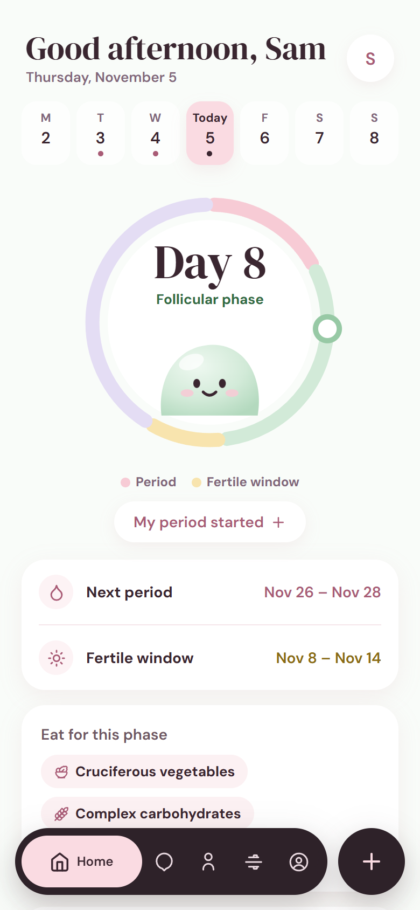
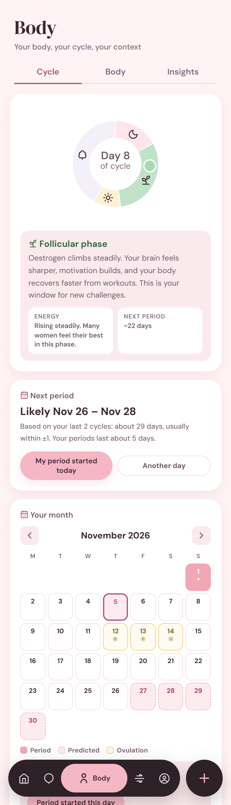
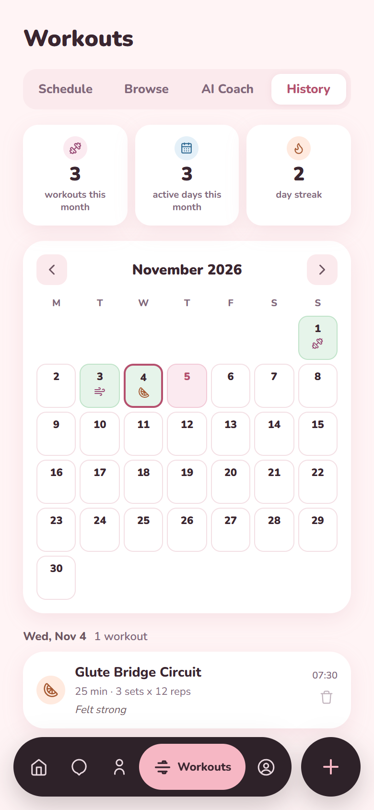
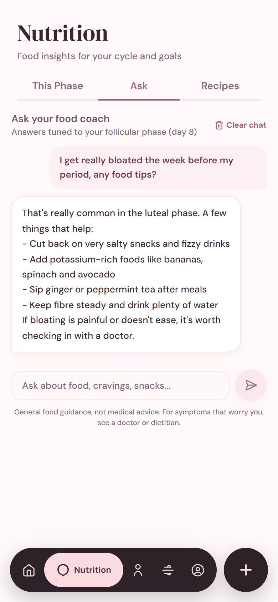
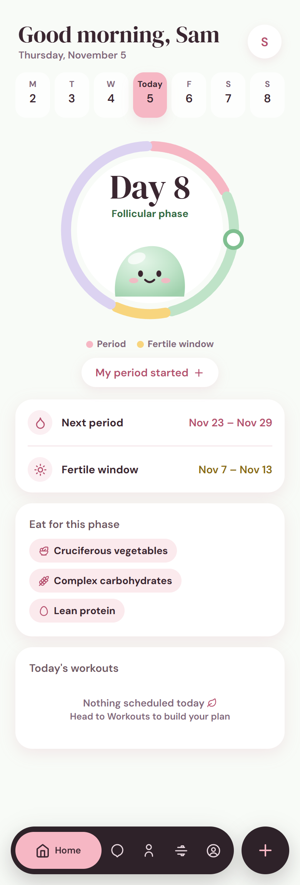
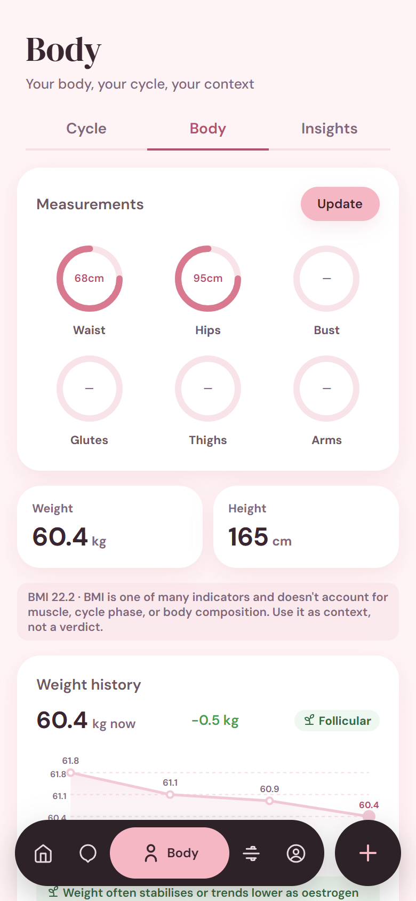
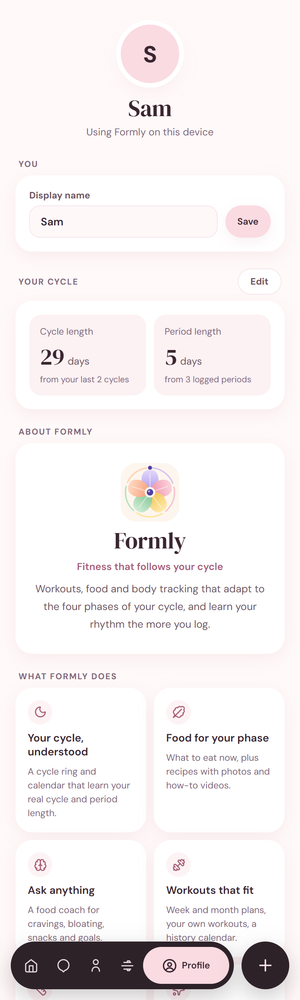

# Formly: Cycle-Aware Fitness & Nutrition for Women

[](https://github.com/franc13e/formly/actions/workflows/ci.yml)

Formly is a mobile-first fitness app that combines workout planning, food guidance and optional menstrual-cycle tracking, with AI coaching that adapts to where you are in your cycle. It installs as a PWA and works offline.

**Live demo:** https://formly-teal.vercel.app

**Tech Stack:** React 19 · TypeScript · Vite · Vitest · FastAPI · Groq LLM API · Supabase (auth + Postgres) · Openverse (recipe photos) · Vercel (frontend + serverless API)

---

## Screenshots

<p align="center">
  
  
  
</p>
<p align="center">
  
  
</p>
<p align="center">
  
  
</p>

## Features

**Cycle**
- **Home cycle ring**: the current cycle day and phase in a ring of phases, with a mascot whose colour and mood follow the phase; the whole screen is tinted by phase
- **Monthly cycle calendar**: logged periods (with flow level), predicted periods and ovulation days; tap any day to start a period, mark its flow as light, medium or heavy, or mark "no flow" to end it
- **Learned predictions**: next period shown as a range, based on your own logged cycles (see [How predictions work](#how-predictions-work))
- **Late periods**: shown as "X days late" with a one-tap "My period started"
- **Editable period length**, learned from the days you log a period ending

**Workouts**
- **Week / month schedule**: plan workouts on any day, mark rest days and move planned workouts to another day
- **History calendar**: each logged workout's icon on the day you did it, plus monthly totals and your streak
- **Your own workouts**: create, edit and delete custom workouts with an icon (suggested from the name)
- **AI coach**: personalised plans from your goal, activity level, focus areas and current phase

**Nutrition**
- **This phase**: foods to focus on and ease off, with the reason for each
- **Ask**: a food-coach chat for any food question (cravings, bloating, pre-workout meals, eating for a goal), aware of your cycle phase; it points to a doctor or dietitian for medical concerns
- **Recipes**: 3 meals and 2 drinks for each phase, with ingredients, steps, photos and YouTube / TikTok links; "Make me a recipe" generates one from what you have at home, and you can save favourites

**Everywhere**
- **Soft Blush design**: DM Serif Display headings over DM Sans, one rose accent on a blush ground, phase colours only where they carry meaning (ring, calendar, tags), line icons instead of emoji
- **Quick add**: the + button logs a period start or end, or jumps to logging a workout, the food coach or measurements
- **Body measurements**: weight and measurements with a history chart per metric, the change since last time, and supportive, cycle-aware AI feedback
- **Optional accounts**: sign up to back up and sync across devices, or keep everything in the browser
- **Local-first PWA**: installable, works offline from localStorage; signed-in users' data syncs to Supabase in the background

## How predictions work

Formly is a calendar-based estimate. It cannot detect ovulation itself, so don't use it as contraception.

| Phase | How it's worked out | e.g. in a 30-day cycle |
|---|---|---|
| Period | Your period length (setting, or the average of logged periods) | Days 1–5 |
| Follicular | From the end of your period until ovulation | Days 6–15 |
| Ovulation | About 14 days before the next period | Days 16–18 |
| Luteal | From ovulation until the next period (fairly steady, ~12–14 days) | Days 19–30 |

- **Cycle length** is the average gap between your last 6 logged period starts; gaps over 50 days are ignored as missed logs. Until a full cycle is logged, your cycle-length setting is used.
- **The next period** is shown as a window: the predicted date ± how much your own cycles vary (1–7 days).
- **Ovulation moves with cycle length**, so the follicular phase is the part that stretches or shrinks.
- **Late periods**: up to 10 days past the expected start, Formly shows the period as late instead of starting a new cycle.

The engine lives in [`src/lib/cycle.ts`](src/lib/cycle.ts) and is covered by unit tests.

## Project Structure

```
formly/
├── src/
│   ├── main.tsx          # React entry point
│   ├── App.tsx           # Root component: app state, persistence, navigation, quick add
│   ├── types.ts          # Shared domain types
│   ├── theme.ts          # Design tokens (Soft Blush) and global CSS
│   ├── pages/            # Onboarding, Dashboard, Nutrition, Body, Workouts, Settings
│   ├── components/       # Cycle ring, mascot, month calendar, glyph icons, food chat, recipes, charts
│   ├── data/             # Static data: workouts, foods, recipes, coach options, tabs
│   ├── hooks/            # useToast, useRecipePhoto
│   ├── auth/             # Sign-in screen, auth gate and account context
│   └── lib/              # API client, storage, cloud sync, Supabase client, cycle engine (+ unit tests)
├── supabase/schema.sql   # user_state table + row-level security policies
├── api/index.py          # Vercel serverless entry for the FastAPI app
├── main.py               # FastAPI backend (AI endpoints, recipe photos)
├── tests/                # Backend tests (pytest)
├── requirements.txt      # Python dependencies
├── package.json          # Frontend dependencies and scripts
├── vite.config.ts        # Vite + Vitest config
└── vercel.json           # Vercel deployment config
```

## Accounts & Sync

Accounts are optional and use **Supabase Auth**. Each user's app data is stored as one row in a `user_state` table protected by **row-level security**, so users can only read and write their own data ([schema](supabase/schema.sql)).

- On sign-in, cloud data replaces the local copy; a brand-new account is seeded from the current local data, so guest progress carries over.
- Every change is saved locally first and synced in the background (debounced, and flushed when the tab is hidden).
- Without Supabase configured, the app runs fully local. The Supabase SDK is lazy-loaded, so local-only visitors don't download it.

The frontend reads the public Supabase URL and anon key from `GET /api/config`, which picks them up from the Vercel ↔ Supabase integration's environment variables.

## API Endpoints

| Method | Endpoint | Description |
|---|---|---|
| `POST` | `/api/food-chat` | Cycle-aware food coach chat |
| `POST` | `/api/recipe` | Generate a recipe for a phase from optional ingredients |
| `GET` | `/api/recipe-photo?q=` | An openly licensed food photo with credit (Openverse; Pexels if `PEXELS_API_KEY` is set) |
| `POST` | `/api/ai-plan` | Generate a personalised workout and nutrition plan |
| `POST` | `/api/body-insight` | Cycle-aware feedback on body measurements |
| `POST` | `/api/nutrition` | Estimate macros from a food description |
| `POST` | `/api/health-check` | Feedback on health goals |
| `POST` | `/api/suggest-goals` | Nutrient priorities for the user's goals |
| `GET` | `/api/config` | Public Supabase URL and anon key (if accounts are enabled) |
| `GET` | `/api/health` | Health check |

Recipe photos are Creative Commons or public-domain images found through [Openverse](https://openverse.org); each one is shown with its photographer, licence and a link to the source. Photos for the built-in recipes ship with the app (`src/data/recipePhotos.ts`, regenerated with `python scripts/fetch_recipe_photos.py`); photos for AI recipes are looked up from the browser, so each user has their own Openverse rate limit.

## Running Locally

### Backend

```bash
pip install -r requirements.txt
echo "GROQ_API_KEY=your_key_here" > .env
uvicorn main:app --reload
```

### Frontend

```bash
npm install
npm run dev
```

Checks:

```bash
npm run typecheck   # TypeScript (strict), no emit
npm run lint        # ESLint
npm test            # Vitest unit tests
npm run build       # production build to dist/
pytest -q tests     # backend tests
```

> In development, Vite proxies `/api` to the backend on port 8000. In production, Vercel serves the FastAPI app from `api/index.py` on the same domain, so set `GROQ_API_KEY` in the Vercel project.
